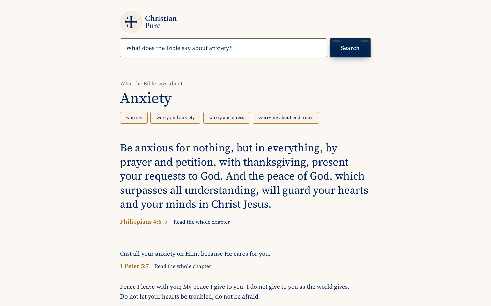

# Christian Pure Bible Search

Search the Bible and Christian Pure's prayers on your own computer. Type a worry, a question or a verse, such as *anxiety*, *a prayer before a meal* or *Psalm 23*. You get what the Bible says about it, a prayer to pray, and Christian Pure articles to read next.

Everything runs on your computer. Your searches are not sent anywhere, and the app works with no internet connection.



## What it does

- Finds passages for 6,699 subjects, from *anxiety* and *grief* to *money worries* and *marriage*, and suggests close subjects to try next.
- Opens any reference you type (*John 3:16*, *Romans 8*) and reads whole chapters, with previous and next.
- Offers one of 340 prayers from [christianpure.com](https://christianpure.com/?utm_source=github&utm_medium=app&utm_campaign=bible-search-app) for the need, with a link to the article it comes from.
- Takes about 20 MB once set up (plus Python), or about 210 MB as a Docker image. It needs no graphics card and no account.

## Install

**Pinokio.** Search Discover for *Christian Pure Bible Search*, or paste this repository's address into Pinokio's Download box. Click Install, then Start.

**Docker**

```bash
docker run -d --name christianpure-bible-search -p 8417:8417 -v christianpure-bible-search:/data ghcr.io/christianpure/bible-search:latest
```

Then open http://localhost:8417.

**Umbrel, CasaOS and Unraid.** Install it from the app store on your home server once it is listed. Until then, the files for each store are in [`stores/`](stores/).

**Python 3.9 or newer, nothing else to install**

```bash
git clone https://github.com/christianpure/bible-search.git
cd bible-search
python3 app.py
```

The first start builds the search index in a few seconds.

## Settings

| Setting | What it does | Default |
|---|---|---|
| `PORT` | The port the app listens on | `8417` |
| `HOST` | The address it listens on; use `0.0.0.0` to reach it from other devices | `127.0.0.1` |
| `DATA_DIR` | Where the search index and the prayers are kept | `data/local` |
| `STUDY_OFFLINE` | `1` stops the weekly check for new prayers on christianpure.com | off |

Once a week, when it can, the app downloads the newest prayers and article list from christianpure.com. Those requests carry no cookies, no account and no search words. If the download fails, the copy already in the app is used.

## Where the words come from

- **Bible text:** the Berean Standard Bible, which its publishers have placed in the public domain.
- **Subjects and their verses:** [OpenBible.info](https://www.openbible.info/topics/) topical data, licensed CC BY 4.0. Verses picked on Christian Pure's own verse pages are shown first.
- **Prayers and article list:** Christian Pure. See [`data/seed/NOTICE`](data/seed/NOTICE).

## Licence

The code is under the MIT licence ([`LICENSE`](LICENSE)). The Christian Pure name and logo, and the prayers and article list in `data/seed/packs/`, belong to Christian Pure and are not covered by the MIT licence. You may use them as part of this app, unchanged.

Questions: admin@christianpure.com
